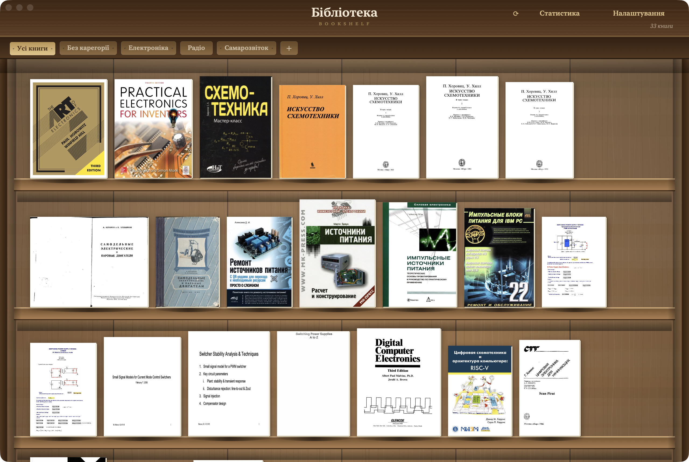
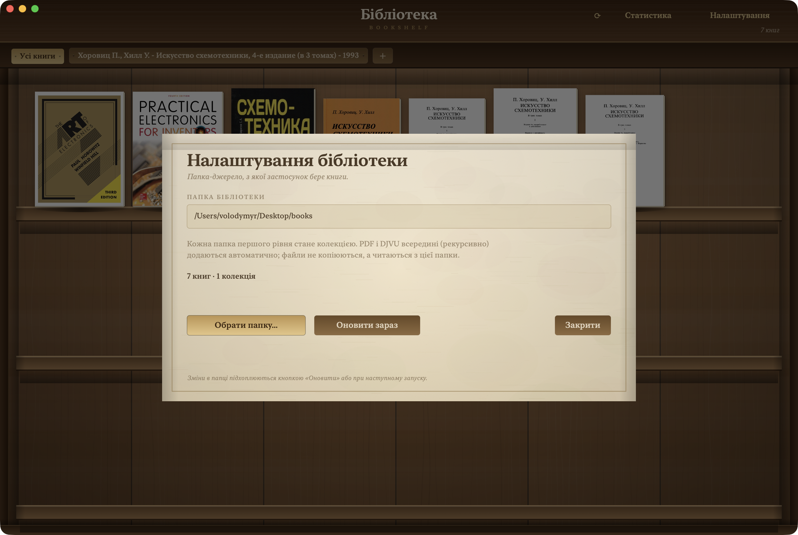
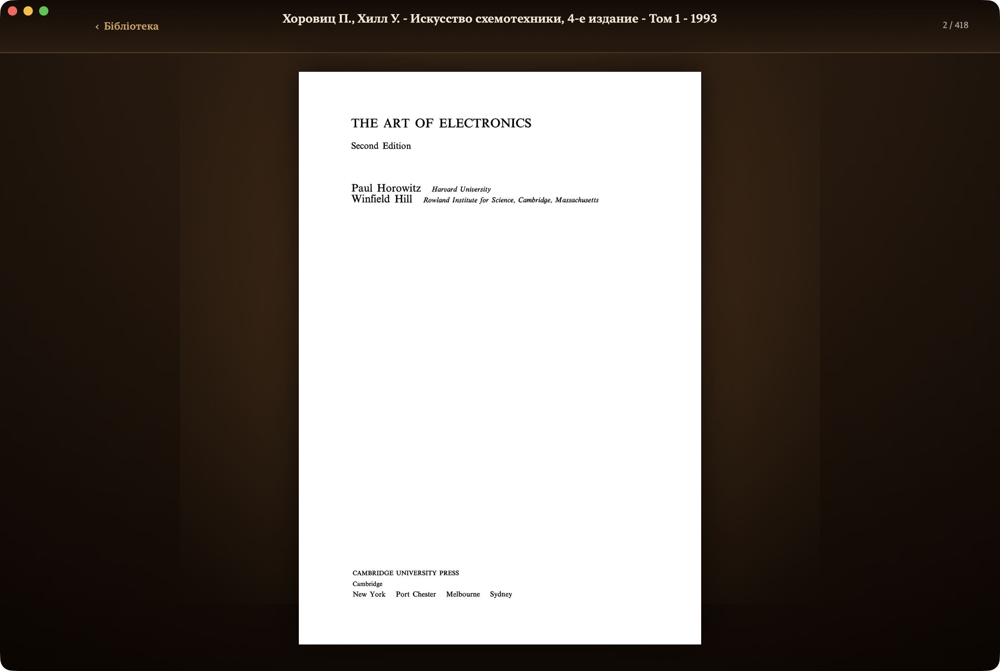
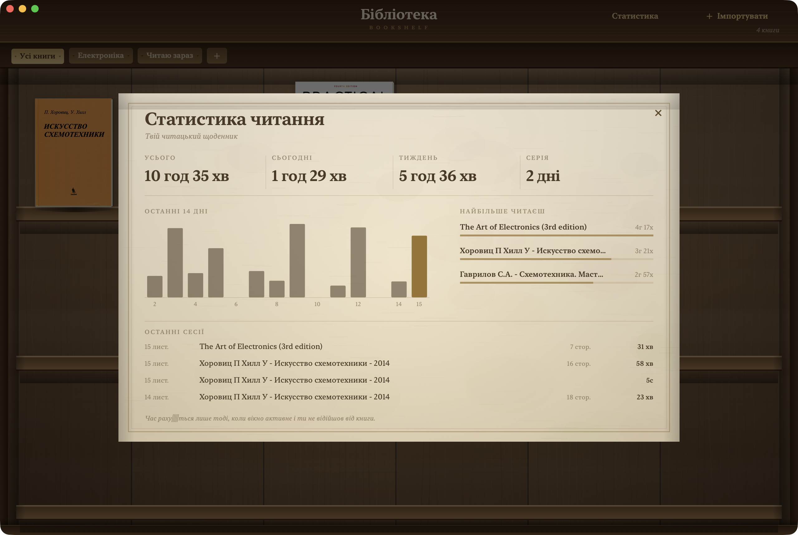
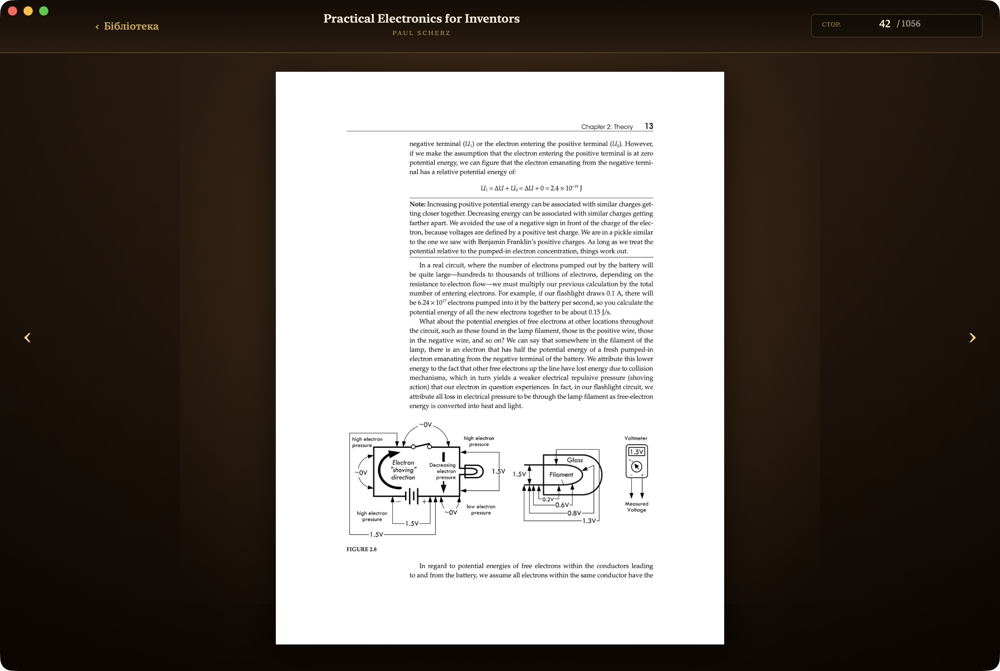
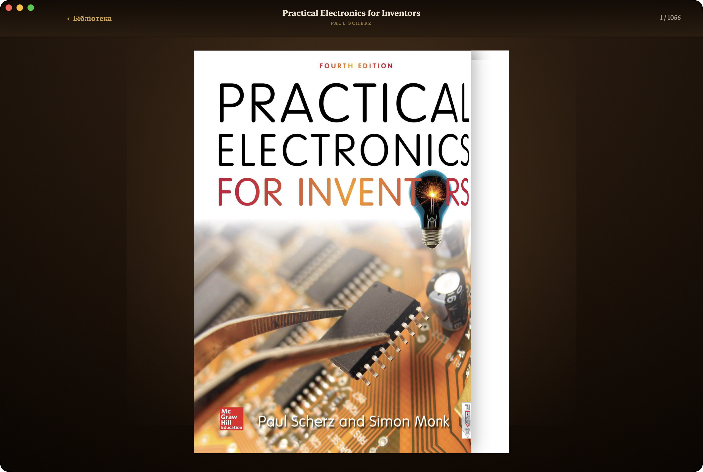

<p align="center"></p>

# Bookshelf — бібліотека з папки

Скевоморфна бібліотека електронних книг для macOS: дерев'яні полиці, 3D-перехід книги
з полиці в режим читання, page-curl, статистика і **тека-джерело**, яка одночасно є
структурою колекцій.



## Встановлення

Готовий підписаний бандл лежить у `dist/Bookshelf.app` (версія 1.0.0), архів —
`dist/Bookshelf-1.0.0.zip`. Перетягни `Bookshelf.app` у `Applications` або запусти:

```bash
open dist/Bookshelf.app
```

Бандл зібраний ad-hoc підписом; для локальної збірки цього достатньо. Дані
застосунку зберігаються в `~/Library/Application Support/Bookshelf` і не залежать
від того, звідки запущено `.app`.

## Запуск

```bash
cd Bookshelf
./scripts/build.sh
open build/Bookshelf.app
# або готовий бандл з іконкою:
./scripts/package.sh
open dist/Bookshelf.app
```

Швидка ітерація без збірки бандла:

```bash
./scripts/run.sh
```

У Xcode: `File → Open… → Bookshelf/Package.swift`, схема `Bookshelf`.
Вимоги: macOS 14+, Xcode 15+ (перевірено на Xcode 27.2, Swift 6.4).

## Папка-джерело

При першому запуску застосунок просить обрати папку з книгами. Далі:

- **кожна папка першого рівня — це колекція** (`Електроніка`, `Саморозвиток`, …);
- PDF і DJVU всередині (рекурсивно) додаються автоматично;
- файли **не копіюються** — застосунок читає їх там, де вони лежать;
- файли в корені папки теж додаються, але без колекції.

Приклад:

```
books/
  Електроніка/
    Схемотехніка.pdf
    Horowitz - Art of Electronics.djvu
  Саморозвиток/
    Атомні звички.pdf
  Nobel Prize Lectures.pdf      ← без колекції
```



- Папка змінюється в **«Налаштуваннях»** (`⌘,` або кнопка вгорі).
- Оновлення бібліотеки: кнопка **⟳**, `Файл → Оновити бібліотеку` (`⌘R`), кнопка
  «Оновити зараз» у налаштуваннях, а також автоматично при кожному запуску.
- Перейменування або переміщення книги/папки в межах бібліотеки **зберігає прогрес**:
  книги впізнаються за SHA-256 вмісту, а не лише за шляхом.
- Якщо файл зник, книга ховається з полиці, але її метадані та історія читання
  залишаються в базі. Якщо файл повернеться — книга знову з'явиться.

Якщо папка недоступна (переміщена, відключений диск, немає дозволу), застосунок
не чистить полицю, а показує помилку — старі книги залишаються на місці.

## DJVU

- DJVU-файли конвертуються один раз у PDF вбудованим `ddjvu` (DjVuLibre); оригінал
  залишається у папці-джерелі, а PDF лежить у `Derived/`.
- Далі книга читається тим самим PDF-рідером: анімація, остання сторінка, статистика —
  все працює як для PDF.
- Обкладинка береться з першої сторінки, де реально є текст/графіка, а не з порожнього
  титульного аркуша.
- `ddjvu` — GPLv2, викликається окремим процесом; текст ліцензії — `Vendor/DjVuLibre-NOTICE.txt`.



## Час читання і статистика

Час рахується автоматично, поки відкрита книга. Сесія йде, лише коли застосунок
активний, вікно книги key, комп'ютер не спить, екран не заблокований і ти не відійшов
від книги (5 хвилин без вводу — пауза). Чекпойнт у SQLite кожні 30 секунд і при
гортанні сторінки; при закритті сесія фіналізується.

**Статистика** — кнопка вгорі або `Файл → Статистика читання…` (`⌘⇧S`): загальний час,
сьогодні, тиждень, серія днів, графік за 14 днів, топ книг, останні сесії.



## Що вже працює

- Дерев'яна бібліотека з полицями, тінями, реальними обкладинками й різними нахилами.
- На екрані завжди **три полиці одного масштабу**. Якщо книг більше — знизу
  додаються нові полиці, а бібліотека прокручується коліщатком або трекпадом.
  Книги не зменшуються і не сплющуються, коли бібліотека росте. Якщо всі книги
  вміщуються на екрані, полиця взагалі не гортається.
- Перехід shelf → reader: затемнення, підйом, обертання обкладинки навколо корінця,
  політ сторінки, передача кастомному рендеру; зворотний перехід.
- Читання PDF і DJVU на власному рендері сторінки: плавний зум без прив'язки до
  прямокутника, панорамування, справжній page-curl із тінню (Core Image).
- Остання сторінка зберігається при гортанні та закритті.
- Колекції з папок, фільтр полиці; ручні колекції теж можливі.
- Відкриття оригінального файлу книги в іншій програмі через контекстне меню.
- Облік активного часу, історія сесій, статистика.
- Порожній стан і onboarding, якщо папку ще не обрано.

## Керування

- **Наведення** — підйом книги; **клік** — відкрити.
- **Коліщатко / трекпад на полиці** — прокрутка вниз до наступних полиць.
- **Пінч на трекпаді** — зум сторінки (до 300%); сторінка росте за межі свого
  прямокутника, а не обрізається ним. **Перетягування** або скрол — панорамування.
- **Подвійний клік** або клавіша **0** — скинути зум.
- **Стрілки «‹» / «›»** на полях, **← / →** або **Space** — перегорнути сторінку.
  Якщо сторінка збільшена, вона спершу плавно зменшується до повного розміру,
  і вже потім запускається page-curl.
- **Швидке гортання:** часте натискання прискорює анімацію, а з третього поспіль
  натискання сторінки перегортаються миттєво, без анімації — зручно, коли треба
  швидко пробігти книгу.
- **Поле «СТОР.»** у правому верхньому куті: введи номер сторінки й натисни `Return`
  (або клікни поза полем) — рідер одразу перейде на цю сторінку.
- **Esc** або «‹ Бібліотека» — закрити книгу.
- **Правий клік на книзі** — «Відкрити», «Відкрити за допомогою» (список програм,
  які вміють відкривати оригінал; для DJVU — саме `.djvu`, наприклад DjVu Reader Pro),
  «Інша програма…», «Показати у Finder» і «Колекції».
- **Правий клік на вкладці** — перейменувати/видалити ручну колекцію. Папкові
  керуються файловою системою.





## Дані

```
~/Library/Application Support/Bookshelf/
  library.sqlite          # книги, прогрес, колекції, сесії
  Covers/<id>.jpg         # обкладинки
  Derived/<id>/book.pdf   # PDF, згенеровані з DJVU
```

Схема: `book`, `progress`, `collection`, `book_collection`, `reading_session`.
Книги з папки-джерела не дублюються в Application Support; там лежать лише похідні файли.

Для тестів можна перевизначити теку даних і корінь бібліотеки:

```bash
BOOKSHELF_DATA_DIR=/tmp/bookshelf-test \
BOOKSHELF_LIBRARY_ROOT=/tmp/books \
.build/debug/Bookshelf
```

## Чого ще немає

- Пошук по тексту, редагування метаданих, видалення книг.
- Нативний рендер DJVU без одноразової конвертації.
- Живе стеження за папкою (FSEvents) — оновлення при запуску/вручну.
- Експорт статистики.

## Структура

```
Sources/Bookshelf/
  main.swift                     запуск NSApplication
  AppDelegate.swift              вікно, меню, CLI-прапорці
  Models.swift                   Book
  LibraryPaths.swift             Application Support, Derived, Covers
  LibrarySettings.swift          збережена папка-джерело (+ env override)
  LibraryStore.swift             SQLite-сховище, міграції, колекції, сесії
  LibraryScanner.swift           сканування папки, категорії, PDF/DJVU
  DjvuConverter.swift            виклик вбудованого ddjvu
  BookCover.swift                кеш обкладинок + fallback
  CoverRenderer.swift            процедурна обкладинка, якщо немає файлу
  Theme.swift / Wood.swift       текстури, шрифти, рендер
  BookLayer.swift                шар книги + hover
  ShelfView.swift                полиця, розкладка, тіні, hit-testing
  HeaderBarView.swift            панель: ⟳, статистика, налаштування
  Collections.swift              модель колекції + смуга вкладок
  LibrarySettingsOverlayView.swift  налаштування / onboarding
  ReaderViewController.swift     кастомний рендер, зум, page-curl, chrome
  ReadingSessionTracker.swift    облік активного часу
  ReadingStats.swift             статистика
  StatsOverlayView.swift         пергаментний екран статистики
  LibraryViewController.swift    політика, сканування, анімація
```

Ключові рішення:

- Полиця — AppKit + Core Animation, не SwiftUI: контроль над 3D, тінями, z-order.
- Папка-джерело — єдине джерело істини; БД лише індексує її.
- PDF читаються на місці, DJVU один раз конвертуються у PDF.
- Для переміщених файлів зберігається SHA-256 вмісту, щоб не втрачати прогрес.

## Debug-прапорці

```bash
.build/debug/Bookshelf --set-root "/path/to/books"   # зберегти корінь і просканувати
.build/debug/Bookshelf --settings                    # відкрити налаштування
.build/debug/Bookshelf --collection "Електроніка"
.build/debug/Bookshelf --open-index 4
.build/debug/Bookshelf --stats
.build/debug/Bookshelf --open-first --auto-close --auto-close-delay 9
.build/debug/Bookshelf --shot out.png --shot-delay 3
.build/debug/Bookshelf --quiet-scan
```

`--shot` робить знімок вікна через `CGWindowListCreateImage` і завершує процес.
`--set-root` використовує той самий механізм, що й вибір папки в налаштуваннях.

## Відомі компроміси

- Категорії — лише папки першого рівня; вкладені папки всередині належать тій самій категорії.
- Перше сканування DJVU може тривати 10–30 секунд на том: показується індикатор без
  прогресу по сторінках.
- Похідні PDF із DJVU займають у кілька разів більше місця, ніж оригінали.
- Файли в корені папки не мають колекції, доки їх не перемістити в папку-категорію.
- Ручні колекції не синхронізуються з папками; папкові не можна перейменувати в застосунку.
- Після перейменування папки перший скан має обчислити SHA-256 файлів (для 7 книг — миттєво,
  для великої бібліотеки — кілька секунд).
- Скролбар полиць прихований заради скевоморфного вигляду; прокрутка — коліщатком/трекпадом.
